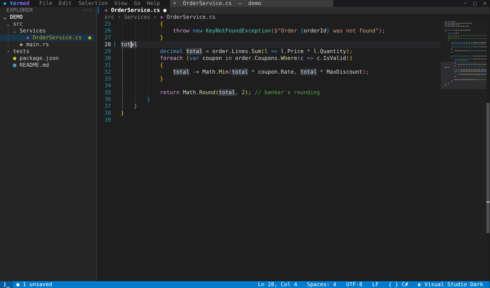
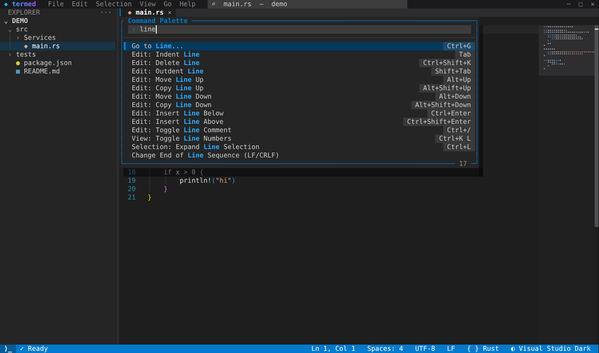
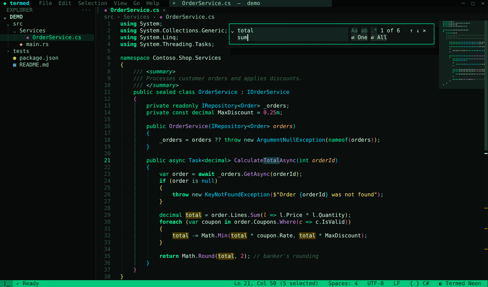
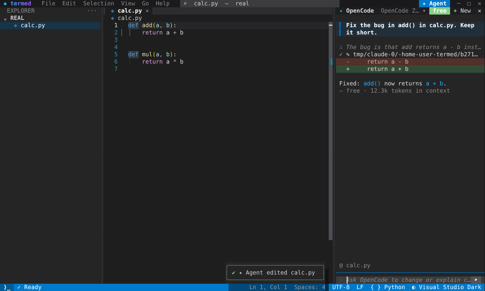
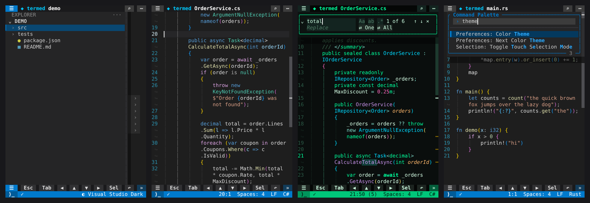
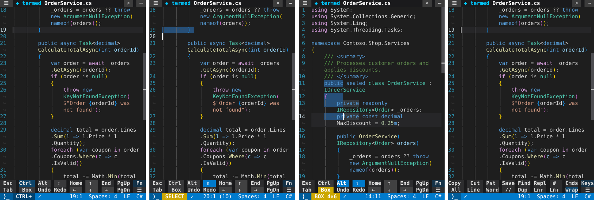
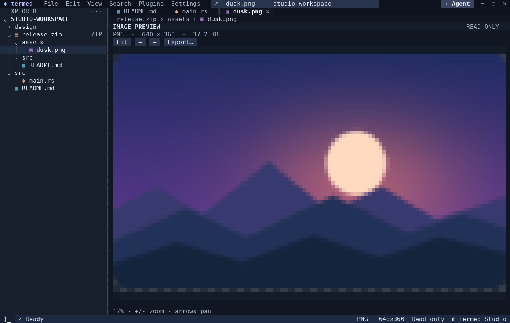

# termed

A terminal code editor that looks and feels like the Visual Studio C# editor, for any language.



| Command palette | Find & replace (Termed Neon theme) |
|---|---|
|  |  |

## AI agent (free, no setup)



Press `Ctrl+K A`, click **✦ Agent** in the title bar, or tap **✦** on a phone. Then ask in plain words, or tap one of the suggestions ("Find bugs in calc.py"). The agent can read and edit your project:

- **Free by default, nothing to install.** termed has a built-in agent, **termed AI**, written in Rust. It uses the free models of [Kilo Gateway](https://kilo.ai/docs/gateway/authentication), which allows anonymous use of its `:free` models with no account and no API key. Because it needs nothing else installed, it also works in **Termux on Android**. It can list, read, search, edit and create files, and run commands; every command asks for your approval first.
- **OpenCode, if you have it.** On desktop, if [OpenCode](https://opencode.ai) is installed, termed uses it by default through the [Agent Client Protocol](https://agentclientprotocol.com); its free models also need no account. You can switch between agents with *Agent: Choose Agent*. On Android, OpenCode's npm package doesn't install, so termed AI is the default there.
- **Free models are busy sometimes.** Shared models can be rate-limited, and one task can take several requests. The built-in agent reports provider failures and tries eligible fallback models before executing a completed tool batch; model requests have a 120-second transport bound. Overwatch enforces a 150-second idle limit and a five-minute root deadline by default, including for NoKey Router. Waiting for children or approval is not an idle stall. Tap the model name to choose one yourself; set `TERMED_FREE_MODEL` to change the legacy built-in starting model.
- **Privacy.** Your prompt, the open file and the files the agent reads are sent to the free model's provider. Free models may log or train on what they receive, so don't use them with secrets or confidential code.
- **You stay in control.** The agent's edits appear in your open files as normal edits with change bars, and one Ctrl+Z (↶) reverts an edit. Diffs show inline in the chat, and tapping a change opens the file at that spot. If the agent asks permission to run a tool, you tap Allow or Reject (or press 1–3).
- **Context is automatic.** The open file, and your selection if there is one, are attached to every message (shown as `@ file.py:12-20` above the prompt). Unsaved files are saved first so the agent sees your latest code.
- **Esc or ■ stops the agent and its task tree.** Partial edits remain for review; Stop resets the provider session, so restate essential context before continuing. + New starts a fresh chat.
- **Other agents work too.** Gemini CLI (`gemini --acp`), Claude Code (`claude-agent-acp`) and Codex (`codex-acp`) are detected automatically if installed; pick one with *Agent: Choose Agent*. Note that these generally need a sign-in or paid plan. Any other ACP agent works with `TERMED_AGENT="command args"`, and `TERMED_AGENT=builtin` forces the built-in agent.
- **On a phone** the panel is a full-screen sheet above the touch keyboard ([screenshot](docs/agent-phone.png)).

## On a phone



termed adapts to phone terminals such as Termux, Blink, Termius and iSH. Below 80 columns it switches to a compact layout automatically; `--mobile` (or `TERMED_MOBILE=1`) forces it at any size. Rotating the device or resizing the window re-lays out the screen immediately.

- **Word wrap.** Long lines wrap, so you never scroll sideways. Wrapped rows keep the line's indent and get a `↪` marker in the gutter, and long expressions break at spaces, commas, brackets or before a `.`. `Alt+Z` or the **Wrap** button toggles it.
- **Touch keyboard.** A fixed 2×9 grid of the keys a phone keyboard lacks, laid out like a laptop: modifiers on the left and an arrow cluster with ↑ above ↓ and ← → beside it. Every key always sits in the same place, so you can build muscle memory. **Fn** switches to an actions page (Copy, Cut, Paste, Save, Find, Replace, go to line, all commands, select all/line/word, comment, duplicate, move line, wrap). The keyboard stays on in Termux, Blink and a-Shell even in landscape; `--no-toolbar` hides it.

  

- **Sticky Ctrl / Alt / Shift.** A soft keyboard can't hold a modifier while you press another key, so the toolbar modifiers latch:
  - **Tap once** and the key is tinted and underlined, and the status bar shows `CTRL+`. It applies to the **next key only**, whether you tap a toolbar key, type on the soft keyboard or tap the text.
  - **Tap twice** and it is **locked** (solid) until you tap it again or press Esc.
  - Modifiers combine. For example, Ctrl+Shift+→ selects a word, Alt+↑ moves the line up, Ctrl+`s` (typed on the soft keyboard) saves, and Ctrl locked lets you press → → → to jump word by word.
  - **Locked Shift is selection mode** (status `SELECT`). Arrows, Home/End and taps extend the selection. Typing replaces the selection and ends the mode, and Copy or Cut also ends it.
- **Box (column) selection.** Tap **Box**, which locks Alt+Shift, then use the arrows or tap a corner to draw a rectangle. The status bar shows `BOX 4×6`, and the box may extend past the end of short lines. Typing, Tab, Backspace and Delete apply to **every line** at once; short lines are padded with spaces. Copy and cut take the column, and pasting a column puts one line on each row. Tap **Box** or Esc to leave. On a hardware keyboard, use Visual Studio's `Alt+Shift+arrows` or Alt+drag with the mouse.
- **Selection by touch.** Double-tap selects a word and triple-tap a line. Shift+tap (Shift latched, then tap) extends the selection to the tapped point.
- **Explorer drawer.** ☰ slides the file tree over the editor. Tapping a file opens it and closes the drawer, and tapping outside dismisses it.
- **Compact chrome.** The title bar has large ☰, ⌕ (open file) and ⋯ (commands) buttons, and tapping the file name opens quick open. The tab row appears only when more than one file is open. Breadcrumbs, the minimap and keyboard hints are hidden. The status bar drops lower-priority items first.
- **Phone-sized overlays.** The command palette is edge to edge, the find/replace bar spans the full width, and dialog text wraps; dialog buttons stack when they don't fit side by side. The welcome screen is a list of large buttons.
- **Gestures and keyboards.** Swipes scroll, a tap moves the cursor (including on wrapped rows), and you can drag the scrollbar. Keyboards that send LF for Return work as Enter.

## Features

**Visual Studio look**
- A *Visual Studio Dark* theme with the VS 2022 C# editor colors (blue keywords, teal types, purple control flow, salmon strings, green comments, teal line numbers). The colors are mapped to TextMate scopes, so every language gets the same look.
- Bracket-pair colorization (gold, orchid, blue) that ignores brackets inside strings and comments, plus matching-bracket highlight.
- Indent guides, with the guide for the current block highlighted.
- Change-tracking margin: green, blue and red bars mark lines added, modified or deleted since the last save.
- Highlight references: other occurrences of the identifier under the caret are tinted.
- A braille-dot **minimap** in syntax colors, and a scrollbar that doubles as an overview ruler showing find hits, changes and the caret.
- Current-line highlight, a thin bar caret, selections that extend past end of line, and whitespace rendering inside selections.
- Chrome: a title bar with a quick-open box, a Solution-Explorer style tree with file icons, tabs with dirty markers, breadcrumbs that show the enclosing class or function, and a clickable status bar.
- Floating panels with rounded borders and drop shadows: command palette, quick open, theme picker with live preview, language picker, go-to-line, a save dialog and toast notifications.
- 15 themes: Visual Studio Dark, Termed Studio (a layered, contrast-tested navy workbench), Termed Neon (a phosphor-green hacker theme), Dracula, Catppuccin, One Half Dark, Nord, Gruvbox, Solarized, Monokai and more.
**Editing**
- Highlighting for 192 languages (C#, C/C++, Rust, Go, Python, TypeScript, Java, Kotlin, Swift, SQL, YAML, Markdown and more; run `termed --list-languages` for the full list).
- Auto-indent, smart block expansion when you press Enter between braces, and auto-closing brackets and quotes with type-over.
- Smart Home, word navigation, Ctrl+D to select the next occurrence, line move and duplicate, toggle comment for each language, and block indent and outdent.
- Box (column) selection like Visual Studio: Alt+Shift+arrows or Alt+drag. Typing, Tab, Backspace and Delete edit every line of the column, and copy/paste work per line.
- Undo and redo that group typing into words, like VS.
- Find and replace with match case, whole word and regex options (including `$1` capture groups), plus replace-one and replace-all.
- **Find in files** (`Ctrl+Shift+F`) and **Replace in Files** (`Ctrl+Shift+H`): pick the folder to search in the *root* box (empty = the project, `~/code/app` and `../other` work too), then filter with the *dirs* box (`src` scopes the search, `!bin;!obj` skips folders and everything under them) and the *files* box (`*.cs;!*.csproj`; `*`, `?`, `[...]` and `**` globs). Results are grouped by file with highlighted hits; `↑`/`↓` walk them, `Enter` opens one, clicking a file header collapses it. Replace All edits open files in memory (so `Ctrl+Z` undoes it and they stay unsaved) and writes the rest to disk; `$1` groups work in regex mode and `⇄` replaces a single hit. `.gitignore` is honored and binary or >2 MB files are skipped.
- Copy with no selection copies the whole line, and pasting it inserts the line above, as in VS.
- Clipboard works through OSC 52 (over SSH and in tmux) and through `wl-copy`, `xclip`, `xsel` or `pbcopy`.
- Full mouse support: click, drag-select, double-click a word, triple-click a line, click the gutter to select a line, scroll, use tabs and the tree, drag the minimap or scrollbar, and resize the sidebar.
- Large files stay responsive. Highlighting is incremental and runs within a time budget, so jumping to the end of a 100k-line file is instant: provisional colors appear first and exact colors fill in over the next frames.

### Images, ZIPs and a richer interface



- **Real image previews:** PNG, JPEG, GIF, WebP, BMP and ICO open on a read-only, theme-aware canvas with transparency, fit/zoom/pan and original-byte export. `+` / `-` zoom, arrows pan, `0` fits; the controls also work by click/tap. SVG stays editable source. The portable half-block renderer needs no terminal graphics protocol; image resolution follows the terminal grid.
- **ZIPs as folders and files:** expand a ZIP in Explorer to browse its virtual folders, edit text members and view image members without extracting. `Ctrl+S` saves a text member with a temporary-file rebuild and conflict checks. Select the ZIP and press **Shift+Enter** to open its read-only overview; Save As copies the archive itself. Text members can also be exported or saved as new members.
- **Termed Studio:** an optional professional palette with layered navy surfaces, a restrained cool accent and readable secondary text. Try `termed -t "Termed Studio" .`, or choose it in the theme picker. Existing defaults are unchanged.

See [images, archive safety, controls and UI/UX research](docs/assets-and-interface.md) for supported operations and limits, including encrypted/symlink archives, metadata caveats and native-graphics limitations. The screenshot is an actual headless application frame.

### Find in files

`Ctrl+Shift+F` (or **Find in Files** in the command palette) opens the panel above the editor. Results update as you type, include unsaved editor buffers (even new or ignored files with a path), and are grouped by file: click a file header to collapse it, click a hit to open it.

The panel has four boxes, cycled with `Tab`: the **query**, the **root** to search in (empty means the project folder; absolute paths, `~` and relative paths such as `../other` are accepted), the **dirs** filter (`src` searches only that folder, `!bin;!obj;!node_modules` skips those folders at any depth) and the **files** filter (`*.cs;!*.csproj`, with `*`, `?`, `[...]` and `**`). Directories are matched against the folder path, files against the name and the path tail, so `src/*.rs` works where it appears.

| Key | Action |
| --- | --- |
| `Tab` / `Shift+Tab` | Next / previous box (query, replace, root, dirs, files) |
| `↑` / `↓`, `PgUp` / `PgDn` | Move through the hits |
| `Enter` | Open the selected hit (in the replace box: replace it) |
| `Ctrl+Enter` | Replace every hit |
| `Ctrl+Shift+Enter` | Replace only the selected hit |
| `Alt+Enter` | Replace every hit in the selected file |
| `Alt+C` / `Alt+W` / `Alt+R` | Toggle case sensitivity, whole word, regex |
| `F5` | Re-run the search after changes made behind the panel |
| `Esc` | Close the panel |

Directory scopes also work below intermediate folders (`src`, `**/src`, `packages/*/src`). Explicit filters still apply to open buffers. Missing/inaccessible roots and filesystem errors are reported instead of silently returning an unexplained empty result. **Search** in the desktop title bar is an alternative to `Ctrl+Shift+F` for terminals that cannot distinguish shifted Ctrl keys.

Regex mode supports capture groups in the replacement (`$1`, `${name}`). Matches inside a folder excluded by the filter are never touched, even by Replace All.

### Settings, AI configuration, sub-agents and skills

Open **Settings** in the desktop title bar or press **Ctrl+,**. The command palette also has **Agent: Configure AI Agent**, **Agent: Manage Sub-agents** and **Skills: Manage Skills**; on a phone, open them through **⋯**. The agent panel's **⚙** button opens AI settings.

- **Persistent workspace preferences:** display options plus AI backend, model, OpenAI-compatible API URL, API-key environment variable, instructions, context, step budgets and command/plugin permissions. Menu changes save to `.termed/settings.json`, layered over user defaults.
- **NoKey Router:** choose **Use NoKey Router** in AI settings; save `ROUTER_API_KEY` locally through a masked field or `termed --router-login`. The saved key stays outside workspace settings, and is sent only to the pinned HTTPS router. `termed --router` selects it for this launch.
- **On-the-fly functions:** agents can define schema-validated pure JSON/text transformation functions and call them immediately. These are task-scoped, resource-bounded implementations, not arbitrary generated code execution.
- **AI plugin tools:** the AI can discover permitted plugins and request an exact command. Every invocation asks for approval, waits for the real result and returns messages plus live-buffer state. Edits stay undoable and unsaved. External ACP agents receive an authenticated stdio MCP bridge when they support MCP servers.
- **Configurable sub-agents:** create and manage isolated built-in specialists with their own role, model, skills, budgets and permissions. Reviewer, Test planner and Coordinator start read-only. The coordinator can delegate to grandchildren within depth, task and deadline limits; the visible overwatch ledger tracks every result and cancels orphaned subtrees.
- **Managed skills:** create/edit, enable/disable, attach and remove Markdown instruction skills in `.termed/skills/<id>/SKILL.md`; user skills are discovered too. Enabled skills can be attached per agent or read on demand.

See [router setup, supervised task trees and generated functions](docs/router-and-supervision.md), and [the configuration and safety guide](docs/agent-configuration.md) for settings JSON, provider setup, scope and limits. External ACP agents and plugins are trusted local processes, **not an OS sandbox**. [Ten additional feature proposals](docs/feature-roadmap.md) describe recommended next steps, not features implemented here.

### Plugins

- Add commands with a folder and a script, in any language. A plugin is a manifest plus a program that speaks JSON-RPC over stdin/stdout, so a Python, Node, Go or Rust script is a plugin; the palette gets its commands and the manifest can claim keybindings. The **Plugins** title-bar menu or `Ctrl+Alt+P` opens the plugin manager (commands, reload, reinstall the bundled set, enable/disable and AI access).
- Reads VS Code extension manifests (`package.json` with `contributes.commands`), so `prettier-vscode`, `eslint` and friends appear in the manager with a clear reason when they need a bridge — and a one-line adapter makes them runnable.
- Four plugins ship in the binary: **text-tools** (`Ctrl+Alt+L` sorts lines, plus de-duplicate, trim, case, format/minify JSON), **todo** (`Ctrl+Alt+T` lists `TODO`/`FIXME` markers across the project), **stats** (words/characters/lines) and **git-info** (`Ctrl+Alt+G` branch and status). See [docs/plugins.md](docs/plugins.md).

## Install

```sh
cargo install --path .
termed                      # open the current folder
termed src/Program.cs       # open a file
termed ~/code/project -t "Termed Neon"
termed -t "Termed Studio" release.zip/src/main.rs # open a ZIP member
termed --mobile src/main.rs # force the phone layout
```

On Android, install [Termux](https://termux.dev), run `pkg install rust git clang`, then `cargo install --path .`. The AI agent works there out of the box.

You need a terminal with truecolor support to get the full look (Windows Terminal, iTerm2, WezTerm, kitty, Alacritty, GNOME Terminal and others). termed detects `COLORTERM=truecolor` and falls back to 256 colors when it isn't set; set `TERMED_TRUECOLOR=1` to force truecolor. Pass `--nerd-font` (or set `TERMED_NERD_FONT=1`) to use Nerd Font file icons.

## Keybindings

| Action | Keys |
|---|---|
| Quick open file | `Ctrl+P` |
| Command palette | `Ctrl+Shift+P`, `F1` |
| Save / save as / save all | `Ctrl+S` / `Ctrl+Alt+S` / `Ctrl+K S` |
| New file / close tab / quit | `Ctrl+N` / `Ctrl+W` / `Ctrl+Q` |
| Next / previous tab, tab *n* | `Ctrl+PgDn` / `Ctrl+PgUp`, `Alt+1…9` |
| Toggle / focus explorer | `Ctrl+B` / `Ctrl+E` |
| ZIP: expand / open as file (Explorer) | `Enter` or `Right` / `Shift+Enter` |
| Image: zoom / pan / fit | `+` and `-` / arrows / `0` or `Home` |
| Find / replace / next / previous | `Ctrl+F` / `Ctrl+H` / `F3` / `Shift+F3` |
| Find / replace in files | `Ctrl+Shift+F` / `Ctrl+Shift+H` |
| Plugin manager | `Ctrl+Alt+P` |
| Settings | `Ctrl+,` |
| Bundled plugins: sort lines / TODOs / git status | `Ctrl+Alt+L` / `Ctrl+Alt+T` / `Ctrl+Alt+G` |
| Find options: case, word, regex | `Alt+C`, `Alt+W`, `Alt+R` |
| Go to line (`line:col`) | `Ctrl+G` |
| Go to matching bracket | `Ctrl+\` |
| Undo / redo | `Ctrl+Z` / `Ctrl+Y`, `Ctrl+Shift+Z` |
| Cut / copy / paste | `Ctrl+X` / `Ctrl+C` / `Ctrl+V` |
| Select all / line / next occurrence | `Ctrl+A` / `Ctrl+L` / `Ctrl+D` |
| Toggle comment | `Ctrl+/` |
| Move line(s) up / down | `Alt+Up` / `Alt+Down` |
| Duplicate line(s) | `Ctrl+Shift+D` |
| Box (column) selection | `Alt+Shift+arrows`, Alt+drag |
| Delete line | `Ctrl+Shift+K` |
| Insert line below / above | `Ctrl+Enter` / `Ctrl+Shift+Enter` |
| Indent / outdent | `Tab` / `Shift+Tab`, `Ctrl+]` / `Ctrl+[` |
| Delete word left / right | `Ctrl+Backspace` or `Alt+Backspace` / `Ctrl+Delete` |
| Color theme picker / next theme | `Ctrl+K T` / `F8` |
| Language mode | `Ctrl+K Ctrl+M` |
| Toggle minimap / whitespace / indent guides / line numbers | `Ctrl+K M` / `W` / `I` / `L` |
| Toggle word wrap | `Alt+Z` |
| AI agent panel | `Ctrl+K A` |

Some combinations (Ctrl+Shift+…, Ctrl+Enter, Ctrl+[) can only be told apart in terminals that support the kitty keyboard protocol, which termed turns on when it is available. In other terminals, Ctrl+Backspace arrives as Ctrl+H (Replace), so use Alt+Backspace to delete a word. Every command can also be run from the command palette.

## Architecture: the library behind each part

| Concern | Library | Why |
|---|---|---|
| Rendering | [ratatui](https://ratatui.rs) | Diffed cell-buffer rendering, so only changed cells are redrawn. The editor paints straight into the buffer to control every cell. |
| Terminal I/O | [crossterm](https://github.com/crossterm-rs/crossterm) | Cross-platform; supports mouse, bracketed paste, the kitty keyboard protocol and caret shape. |
| Text buffer | [ropey](https://github.com/cessen/ropey) | Rope with O(log n) edits and line indexing, the same structure Helix uses. |
| Syntax highlighting | [syntect](https://github.com/trishume/syntect) + [two-face](https://github.com/CosmicHorrorDev/two-face) | Sublime Text / TextMate grammars with bat's extended set of 192 languages, the same grammar format VS Code uses. |
| Fuzzy matching | [nucleo-matcher](https://github.com/helix-editor/nucleo) | The fzf-quality matcher from Helix, used for quick open and the palette. |
| File tree | [ignore](https://github.com/BurntSushi/ripgrep/tree/master/crates/ignore) | ripgrep's walker; respects `.gitignore`. |
| Image preview | [image](https://github.com/image-rs/image) | Bounded decoding, EXIF orientation, alpha-aware half-block canvas. |
| ZIP folders | [zip](https://github.com/zip-rs/zip2) | Virtual member paths, bounded reads and atomic container replacement. |
| Change margin | [similar](https://github.com/mitsuhiko/similar) | Fast line diff against the saved file. |
| Find / replace | [regex](https://github.com/rust-lang/regex) | Linear-time regex with capture-group replacement. |
| AI agents | [Agent Client Protocol](https://agentclientprotocol.com) + [serde_json](https://github.com/serde-rs/json) + [ureq](https://github.com/algesten/ureq) | ACP is the open standard Zed and JetBrains use for coding agents. ureq (with rustls and bundled root certificates) lets the built-in agent reach free models from anywhere, including Android. |
| Text width | [unicode-width](https://github.com/unicode-rs/unicode-width) | Correct columns for CJK and wide characters. |
| Plugins | JSON-RPC 2.0 over stdio | Line-delimited JSON, the same transport as LSP and ACP, so any language can be a plugin. See [docs/plugins.md](docs/plugins.md). |

Source layout:

```
src/
  document.rs     text/preview documents, archive-aware saves and safe exports
  image_view.rs   bounded image decoding, fit/zoom/pan and viewport cache
  archive.rs      ZIP indexing, virtual folders, member reads and conflict-safe writes
  editor.rs       caret/selection model, soft wrap and VS-style editing commands
  highlight.rs    incremental, time-budgeted highlighting + string-aware bracket analysis
  theme.rs        Visual Studio Dark / Termed Studio / Termed Neon + bundled palettes
  agent.rs        Agent Client Protocol client: launches the agent, JSON-RPC, chat model, free-model failover
  builtin_agent.rs  built-in agent: free models over an OpenAI-compatible API, file/search/command tools
  search.rs       find/replace in files: roots, glob filters, walk, replacements
  plugin.rs       plugin host: manifests, JSON-RPC subprocesses, discovery, manager
  config.rs       validated user/workspace preferences and inherited agent restrictions
  management.rs   settings, plugin, specialist and skill menus
  skills.rs       Markdown skill discovery, management and prompt context
  automation.rs   approved plugin tools, pinned buffers and bounded specialist sessions
  tool_bridge.rs  authenticated live-editor MCP relay for external ACP agents
  app.rs          state, key/mouse handling, palette, find/replace, dialogs
  ui/             title bar, explorer/drawer, tabs, code view, minimap, toolbar, overlays
examples/
  snapshot.rs     renders frames to HTML headlessly (used for the screenshots)
plugins/
  text-tools/ todo/ stats/ git-info/   bundled plugins, embedded into the binary
```

## Development

```sh
cargo test --locked         # includes image/ZIP/contrast, phone/touch and scripted agent tests
cargo clippy --all-targets
# Render a frame to HTML, replaying keystrokes, taps and swipes:
cargo run --example snapshot -- out.html 150x42 "Visual Studio Dark" . src/main.rs -- ctrl+p text:editor
cargo run --example snapshot -- phone.html 46x30 "Visual Studio Dark" . src/main.rs -- tap:1,0 swipeup:20,10 resize:100x24
```

Validation in the restricted environment: **152 tests passed**, plus an all-targets check and build in a GitHub-sourced offline dependency harness. Real loopback HTTPS tests cover Bearer authentication, redaction and redirect refusal; a live authenticated router task and the production locked-dependency build remain unverified. See the [current verification details](docs/router-and-supervision.md#verification-and-remaining-checks) and [earlier asset verification notes](docs/assets-and-interface.md#verification).
