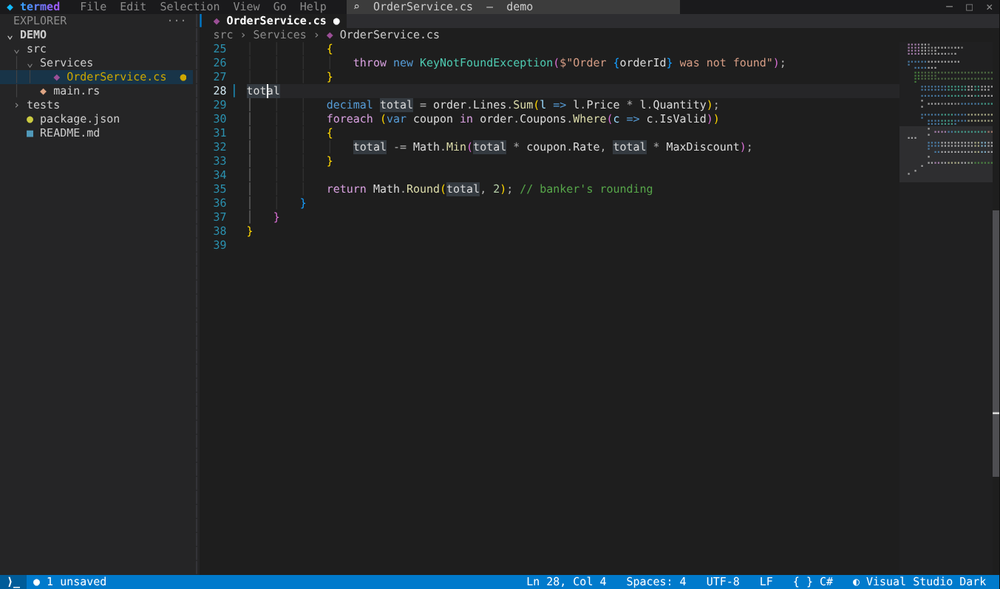
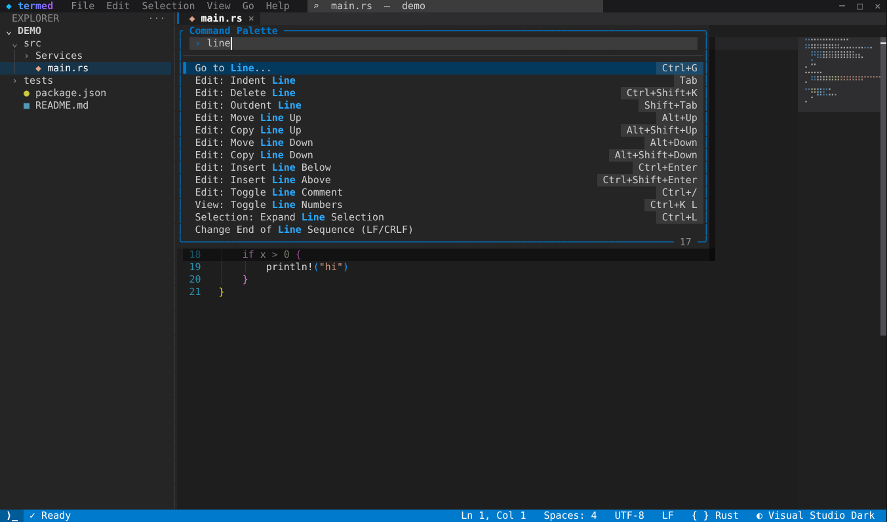
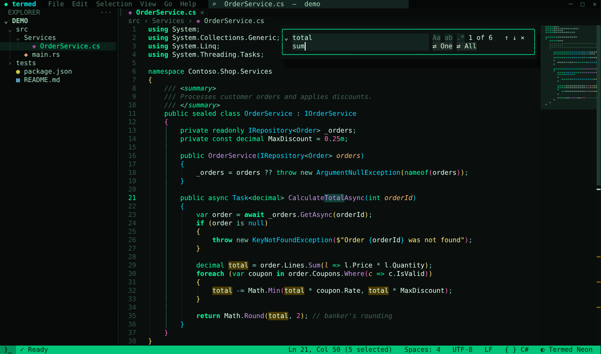
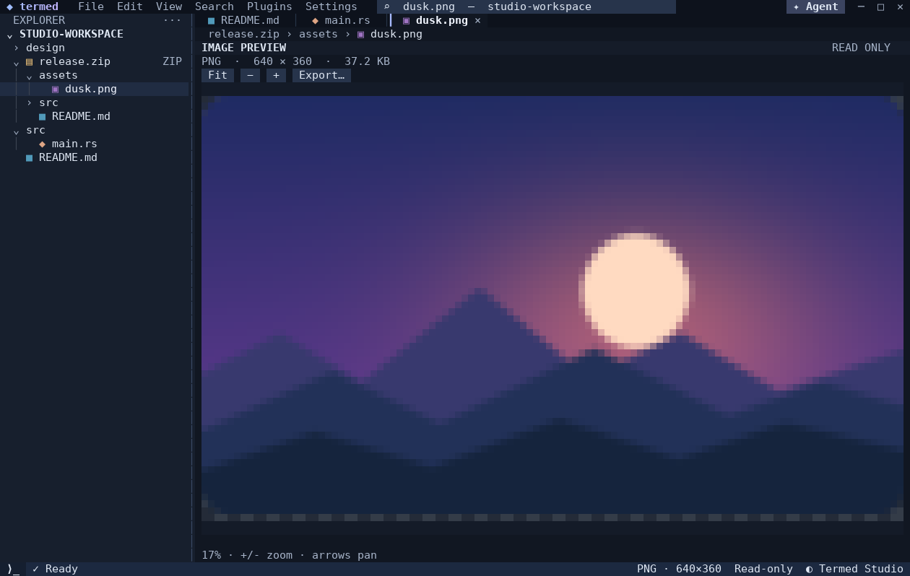

# termed

A terminal code editor that looks and feels like the Visual Studio C# editor, for any language.



| Command palette | Find & replace (Termed Neon theme) |
|---|---|
|  |  |

## Built-in AI agent

Press `Ctrl+K A`, click **✦ Agent** in the title bar, or tap **✦** on a phone. Ask in plain words or tap a suggestion ("Find bugs in calc.py"). The agent can read, edit, create, search and run commands in your project (UTF-8 or UTF-16 files).

- **Built-in by default.** Uses Kono Router `/v1` with `free:code`; set the API key in Settings or run `termed --router-login`.
- **Settings follow you.** User settings save to your config directory and apply across folders. Legacy workspace settings import only if no user settings exist.
- **Local fallback on router failure.** On HTTP 5xx or 401/403, the turn continues on an on-device ONNX model: `pip install -r local_inference/requirements.txt` once, then `termed --local` or **Use Local ONNX Inference**.
- **Free models can be busy.** Availability and rate limits depend on the router. Requests fail after a 150 s stall or 5 min task timeout; long streams aren't cut. Tap the model name to choose another.
- **Privacy.** Your prompt, open file and files the agent reads go to the provider. Free models may log or train on them — don't use them with secrets or confidential code.
- **You stay in control.** Edits show change bars; Ctrl+Z reverts. Command permissions: Allow, Always allow, Reject, Never ask (destructive commands still blocked).
- **100 extra tools** in 10 groups (workspace, text, buffers, edit, filesystem, search, git, UI, code, session) with permission gating. Read-only agents get no write tools; destructive calls need a confirm token.
- **Context is automatic.** The open file and selection attach to every message (`@ file.py:12-20`).
- **Esc or ■ stops the agent and its task tree.** Partial edits remain for review; Stop resets the provider session — restate essential context before continuing. + New starts a fresh chat.
- **Other agents.** Gemini CLI, Claude Code and Codex can be selected via *Agent: Choose Agent*; not automatic and may need sign-in.
- **On a phone** the panel is a full-screen sheet above the touch keyboard ([screenshot](docs/agent-phone.png)).

## On a phone

termed adapts to phone terminals (Termux, Blink, Termius, iSH). Below 80 columns it switches to compact layout automatically; `--mobile` forces it at any size. Resizing re-lays out immediately.

- **Word wrap.** Long lines wrap; `Alt+Z` toggles it.
- **Touch keyboard.** Fixed 2×9 grid (modifiers left, arrows right). `--no-toolbar` hides it.
- **Sticky modifiers.** Tap once: applies to next key. Tap twice: locked until tapped again or Esc.
- **Box selection.** Tap **Box**, lock Alt+Shift, draw a rectangle; typing/Tab/Delete apply to every line. Hardware: `Alt+Shift+arrows` or Alt+drag.
- **Selection by touch.** Double-tap = word, triple-tap = line, Shift+tap extends.
- **Explorer drawer.** ☰ slides the file tree over the editor; tapping outside dismisses it.
- **Compact chrome.** Title bar shows ☰, ⌕, ⋯; tab row only with multiple files; breadcrumbs, minimap and hints hidden.
- **Phone-sized overlays.** Command palette and find/replace span full width; dialog buttons stack; welcome screen is large buttons.
- **Gestures and keyboards.** Swipes scroll, tap moves cursor, drag scrollbar; keyboards sending LF for Return work as Enter.

## Features

**Visual Studio look**
- *Visual Studio Dark* theme mapped to TextMate scopes; bracket-pair colorization; indent guides; change-tracking margin; highlight references; minimap; current-line highlight; change bars; whitespace rendering.
- Chrome: title bar with quick-open, file tree, tabs, breadcrumbs, clickable status bar; floating panels with rounded borders and shadows.
- 15 themes: Visual Studio Dark, Termed Studio, Termed Neon, Dracula, Catppuccin, One Half Dark, Nord, Gruvbox, Solarized, Monokai and more.
- **Editing.** Highlighting for 192 languages (`termed --list-languages`). Auto-indent, smart block expansion, auto-closing brackets/quotes, smart Home, word navigation, Ctrl+D for next occurrence, line move/duplicate, toggle comment, block indent/outdent.
- Box selection (Alt+Shift+arrows or Alt+drag); undo/redo grouped into words; find/replace with case/whole word/regex (`$1` capture groups), replace-one/replace-all.
- Find in files (`Ctrl+Shift+I`) and Replace in Files (`Ctrl+Shift+H`): root/dirs/files filters, `.gitignore` honored, results grouped by file, binary/>2 MB files skipped. Limit default 10,000 (max 100,000).
- Copy with no selection copies whole line; paste inserts above (VS-style). Clipboard via OSC 52, wl-copy, xclip, xsel, pbcopy.
- Full mouse support; incremental highlighting keeps large files responsive.

### Images, ZIPs and a richer interface



- **Real image previews:** PNG, JPEG, GIF, WebP, BMP and ICO open read-only on a theme-aware canvas. SVG stays editable source. Kitty/iTerm2 get native graphics; other terminals use half-block rendering.
- **ZIPs as folders:** expand a ZIP in Explorer, edit text members and view image members without extracting. `Ctrl+S` saves text members; Shift+Enter opens read-only overview.
- **Termed Studio:** optional professional navy palette. `termed -t "Termed Studio" .` or choose in theme picker.

See [images, archive safety, controls and UI/UX research](docs/assets-and-interface.md) for supported operations and limits, including encrypted/symlink archives, metadata caveats and native-graphics limitations. The screenshot is an actual headless application frame.

### Find in files

`Ctrl+Shift+I` opens the find panel. Search runs asynchronously with live progress; **Stop** (`Esc`) cancels. Results group by file, click to open; virtualized list capped at configurable Limit (default 10,000, max 100,000).

Targets: Content, File names, Directory names (`Alt+1`/`Alt+2`/`Alt+3`). Skip binary NUL (`Alt+b`). Fields cycled with Tab: query, replace, root, dirs, files, limit.

Key table: `Tab`/`Shift+Tab` cycle fields; `↑`/`↓` move hits; `Enter` opens/replaces; `Ctrl+Enter` replace all; `Alt+Enter` replace in file; `Esc` stop or close.

Regex supports `$1`/`${name}` capture groups; replacement requires completed Content search; files bounded to 16 MiB (2 MiB for replacement); oversized files reported as skips.

### Settings, AI configuration, sub-agents and skills

Open **Settings** via title bar or `Ctrl+,`; command palette has Agent: Configure AI Agent, Manage Sub-agents, Skills: Manage Skills.

- **Persistent user preferences:** AI backend, model, API URL, API key env var, instructions, context, budgets, permissions. Saved to `~/.config/termed/settings.json`.
- **NoKey Router:** save key via **Save Router API Key**; key stays private and goes only to the pinned HTTPS router. Or run `termed --router-login`; `--router` is launch-only override.
- **On-the-fly functions:** agents define schema-validated JSON/text transforms; task-scoped and resource-bounded, not arbitrary code execution.
- **AI plugin tools:** AI discovers plugins and requests commands; every invocation asks approval; edits undoable/unsaved. External ACP agents get authenticated stdio MCP bridge.
- **Extended AI toolkit:** 100 host tools in ten groups; `list_toolkit`/`describe_tool`/`session_summary` discover schemas; `scratchpad_read`/`scratchpad_write` keep notes; paths confined to project; edits are live buffers.
- **Configurable sub-agents:** Reviewer, Test planner, Coordinator start read-only; coordinator delegates within depth/deadline limits; overwatch ledger tracks results and cancels orphaned subtrees.
- **Managed skills:** create/edit/enable/disable Markdown skills in `.termed/skills/<id>/SKILL.md`; enabled skills attach per agent.

See [router setup](docs/router-and-supervision.md), [local ONNX](docs/local-inference.md), [code intelligence](docs/code-intelligence.md) and [configuration/safety](docs/agent-configuration.md). External ACP agents and plugins are trusted local processes, **not an OS sandbox**.

### Plugins

- **Add commands** with a manifest plus a JSON-RPC-over-stdio program; Python, Node, Go or Rust scripts are plugins. Plugin manager via title bar or `Ctrl+Alt+P`. VS Code manifests (`package.json` with `contributes.commands`) are supported with a one-line adapter.
- **Code intelligence** without a language server: `Ctrl+Shift+Space` context menu for go to definition (`F12`), find references (`Shift+F12`), inspect (`Ctrl+F2`), rename (`F2`), extract block, sort/dedupe selection.
- **Semantic search** (`Ctrl+Alt+F`) ranks the project via on-device ONNX encoder. **Agent: Review the Project for Obvious Bugs** lists duplicates, swallowed errors, unbalanced brackets, TODOs — applies nothing without approval.
- Five bundled plugins: **markdown-preview** (preview browser/here), **text-tools** (`Ctrl+Alt+L`: sort, dedupe, trim, case, JSON format/minify), **todo** (`Ctrl+Alt+T`), **stats** (words/characters/lines), **git-info** (`Ctrl+Alt+G`).

## Install

```sh
cargo install --path .
termed                      # open the current folder
termed src/Program.cs       # open a file
termed ~/code/project -t "Termed Neon"
termed -t "Termed Studio" release.zip/src/main.rs # open a ZIP member
termed --mobile src/main.rs # force the phone layout
```

On Android: install [Termux](https://termux.dev), run `pkg install rust git clang`, then `cargo install --path .`. The built-in AI agent also works there after router key setup.

Commands the AI runs use the machine's own shell (`/bin/sh` on Linux/macOS, `sh` on Windows via Git Bash/MSYS2/Cygwin/WSL, else `cmd.exe`). Set `TERMED_SHELL` to choose another.

You need a terminal with truecolor support (Windows Terminal, iTerm2, WezTerm, kitty, Alacritty, GNOME Terminal and others); set `TERMED_TRUECOLOR=1` to force truecolor. Pass `--nerd-font` or set `TERMED_NERD_FONT=1` for Nerd Font file icons.

## Keybindings

| Action | Keys |
|---|---|
| Quick open | `Ctrl+P` |
| Command palette | `Ctrl+Shift+P`, `F1` |
| Save / save all | `Ctrl+S` / `Ctrl+K S` |
| New file / close tab / quit | `Ctrl+N` / `Ctrl+W` / `Ctrl+Q` |
| Next / previous tab | `Ctrl+PgDn` / `Ctrl+PgUp` |
| Toggle / focus explorer | `Ctrl+B` / `Ctrl+E` |
| Find / replace | `Ctrl+F` / `Ctrl+H` / `F3` / `Shift+F3` |
| Find in files | `Ctrl+Shift+I` / `Ctrl+Shift+H` |
| Plugin manager | `Ctrl+Alt+P` |
| Settings | `Ctrl+,` |
| Bundled plugins: sort / TODOs / git status | `Ctrl+Alt+L` / `Ctrl+Alt+T` / `Ctrl+Alt+G` |
| Markdown: preview in browser / preview here | `Ctrl+Shift+M` / command palette |
| AI agent panel | `Ctrl+K A` |

In the command menu (`F1`), press `Alt` plus a highlighted letter to run its action. For example, `Alt+O` opens Go to File, `Alt+S` saves, and `Alt+A` opens AI settings. Typing the letter alone still searches the menu.

Some Ctrl+Shift+ combinations work only with kitty keyboard protocol support; in other terminals Ctrl+Backspace arrives as Ctrl+H (Replace). Use Alt+Backspace to delete a word. Every command runs from the command palette too.

## Architecture

| Concern | Library |
|---|---|
| Rendering | [ratatui](https://ratatui.rs) — diffed cell-buffer rendering |
| Terminal I/O | [crossterm](https://github.com/crossterm-rs/crossterm) — cross-platform, mouse, bracketed paste, kitty protocol |
| Text buffer | [ropey](https://github.com/cessen/ropey) — rope with O(log n) edits |
| Syntax highlighting | [syntect](https://github.com/trishume/syntect) + [two-face](https://github.com/CosmicHorrorDev/two-face) — 192 languages |
| Fuzzy matching | [nucleo-matcher](https://github.com/helix-editor/nucleo) — fzf-quality |
| File tree | [ignore](https://github.com/BurntSushi/ripgrep/tree/master/crates/ignore) — ripgrep walker |
| Image preview | [image](https://github.com/image-rs/image) — bounded decoding, Kitty/iTerm2 native graphics |
| ZIP folders | [zip](https://github.com/zip-rs/zip2) — virtual member paths, bounded reads |
| Change margin | [similar](https://github.com/mitsuhiko/similar) — fast line diff |
| Find / replace | [regex](https://github.com/rust-lang/regex) + [ignore](https://github.com/BurntSushi/ripgrep/tree/master/crates/ignore) + [memchr](https://github.com/BurntSushi/memchr) |
| AI agents | [Agent Client Protocol](https://agentclientprotocol.com) + [serde_json](https://github.com/serde-rs/json) + [ureq](https://github.com/algesten/ureq) |
| Text width | [unicode-width](https://github.com/unicode-rs/unicode-width) |
| Plugins | JSON-RPC 2.0 over stdio |

Source layout:
```
src/
  document.rs     text/preview documents, archive-aware saves, safe exports
  image_view.rs   bounded image decoding, fit/zoom/pan, viewport cache
  archive.rs      ZIP indexing, virtual folders, member reads/writes
  editor.rs       caret/selection model, soft wrap, VS-style commands
  highlight.rs    incremental highlighting + string-aware bracket analysis
  theme.rs        Visual Studio Dark / Termed Studio / Termed Neon + palettes
  agent.rs        Agent Client Protocol client, JSON-RPC, chat model
  builtin_agent.rs  free models over OpenAI-compatible API, file/search/command tools
  shell.rs        picks host shell for AI commands
  search.rs       find/replace in files: roots, glob filters, walk, replacements
  plugin.rs       plugin host: manifests, JSON-RPC subprocesses, discovery, manager
  config.rs       validated user preferences, legacy migration
  management.rs   settings, plugin, specialist, skill menus
  skills.rs       Markdown skill discovery, management, prompt context
  automation.rs   approved plugin tools, pinned buffers, bounded specialist sessions
  tool_bridge.rs  authenticated live-editor MCP relay for external ACP agents
  toolkit.rs      100 capability-gated host tools: workspace, text, buffers, edits, files, search, git
  app.rs          state, key/mouse handling, palette, find/replace, dialogs
  ui/             title bar, explorer/drawer, tabs, code view, minimap, toolbar, overlays
examples/
  snapshot.rs     renders frames to HTML headlessly
plugins/
  text-tools/ todo/ stats/ git-info/   bundled plugins, embedded into the binary
```

## Development

```sh
cargo test --locked         # includes image/ZIP/contrast, phone/touch, scripted agent tests
cargo clippy --all-targets
# Render a frame to HTML:
cargo run --example snapshot -- out.html 150x42 "Visual Studio Dark" . src/main.rs -- ctrl+p text:editor
```

Tests use Python 3 for local ACP/provider fixtures; some HTTPS tests also need OpenSSL. Run locked build and tests on each target platform before release.