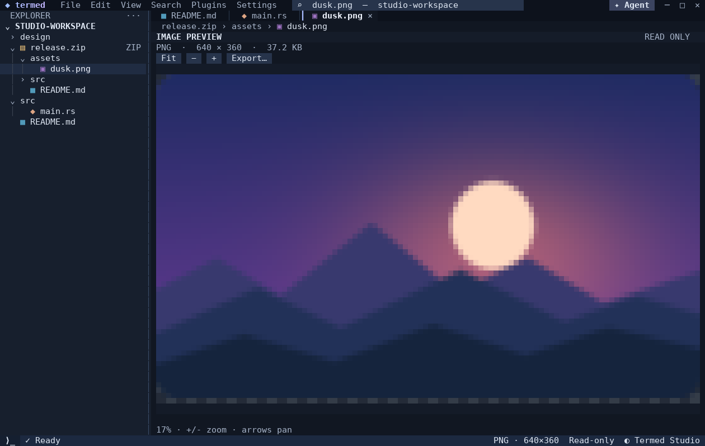

# Images, ZIP workspaces and the Studio interface



*Actual headless application frame at 140 × 42 terminal cells, not a design mockup. The sample landscape is a generated test illustration; it demonstrates the portable half-block renderer, including transparent corners.*

## Images

Existing PNG, JPEG, GIF, WebP, BMP and ICO files open in a **read-only image canvas**, including image members inside ZIP files. The loader detects image signatures as well as extensions; binary image bytes are not converted into lossy text.

- Aspect-preserving fit, centered image, transparency checkerboard and format/dimension metadata.
- **Actual pixels (1:1)**: `1` or the **1:1** control shows one source pixel per terminal pixel where supported; zooming out from 1:1 preserves magnification via the real viewport.
- JPEG EXIF orientation is applied without changing original bytes.
- Viewport-sized rendering cache: zooming does not allocate an enormous zoomed bitmap. Downscaling uses premultiplied alpha with Lanczos/triangle filtering and a mip step; panning happens before resizing.
- Text editing, replacement and editor plugins cannot modify the preview. **Save As** exports original encoded bytes.

| Control | Action |
|---|---|
| `+` or `=` / `-` | Zoom in / out |
| Mouse wheel over the viewer | Zoom in / out |
| Arrow keys | Pan a zoomed image |
| `0` or `Home` | Fit and reset pan |
| `1` | Actual pixels (1:1) |
| **Fit**, **1:1**, **−**, **+** | Click/tap viewer controls |
| **Export…** or `Ctrl+Alt+S` | Export the original image to a regular file |

The command palette also includes **Image: Zoom In**, **Image: Zoom Out**, **Image: Fit to View** and **Image: Actual Size (1:1)**. Select/open the same image again to refresh a cached preview after an external change; merely switching tabs preserves its current view.

### Format and display limits

- On Kitty, Ghostty and WezTerm the canvas uses the Kitty graphics protocol; on iTerm2 it uses inline PNG images. `TERMED_IMAGE_PROTOCOL=kitty|iterm2|half-block` overrides detection.
- Other terminals use Unicode half-blocks; truecolor gives the best result (`TERMED_TRUECOLOR=1` can force it). Sixel not implemented.
- Animation not played; GIF displays a static frame.
- SVG remains editable XML. TIFF, AVIF and other codecs not enabled; unsupported or corrupt images report an error.
- Input capped at 32 MiB, decoded dimensions at 16 megapixels, decoder allocation budget at 128 MiB.

## ZIP files: folder view and file view

ZIPs are virtual folders, not extracted directories. An actual filesystem directory named `something.zip` still behaves as an ordinary directory.

### Browse as a folder

1. Select a `.zip` in Explorer; its row has an archive icon and **ZIP** badge.
2. Press `Enter` or `Right`, or click/tap it, to expand it. `Left` collapses it or selects the parent.
3. Open a member just like a normal file. Intermediate folders appear even if the ZIP omitted explicit directory entries.

Virtual paths:

```text
release.zip/src/main.rs
release.zip/assets/dusk.png
```

Text members support syntax highlighting, normal editing and undo/redo. Image members use the same image canvas as regular image files. Virtual paths can be passed to the CLI:

```sh
termed -t "Termed Studio" release.zip/src/main.rs
```

### Open as a file

Select the ZIP row and press **Shift+Enter**, or run **Archive: Open Selected ZIP as File**. This opens a read-only archive overview with member count, expanded sizes and a listing of the first 200 entries.

**Save As** on the overview copies the original ZIP bytes. Reopen with Shift+Enter to refresh after the archive changes. **Explorer: Refresh** clears cached folder listings after external changes.

### Edit, save and export members

- `Ctrl+S` on a text member builds a temporary sibling ZIP, raw-copies untouched members, writes the changed member, flushes the temp file and replaces the original by rename. Failed saves keep the buffer dirty and clean up the temp file.
- Archive-level comments, ordinary member Unix permissions and untouched member data are retained. CRLF text members retain CRLF on disk.
- Separate tabs can save different members; saves rebase on the current archive. If the **same member's CRC changes**, saving is refused and edits are kept. Export with Save As or reopen after closing the edited buffer.
- **Save As** from a text member writes a regular text file. To create another member, use a destination such as `release.zip/new/folder/notes.txt` — the container ZIP must exist.
- **Save As** from an image member exports its original image bytes to a regular file. Exporting images into ZIPs is not implemented.

### Archive safety and boundaries

| Limit | Behavior |
|---|---|
| Container size | At most 256 MiB |
| Entry count | At most 10,000 |
| Expanded member | At most 32 MiB per opened/written member |
| Unsafe paths | Traversal, absolute/drive paths, backslashes, control characters and file/folder conflicts are refused |
| ZIP symlinks | Never followed; archives containing them cannot be rewritten |
| Encryption | No password/decryption; archives with encrypted members cannot be rewritten |
| Compression | Stored and Deflate members can be opened; unsupported compression reports an error |
| Nested archives | ZIPs inside ZIPs are not recursively mounted |
| Archive editing scope | Content editing, not a lossless ZIP-metadata editor — per-member comments/extra fields and signatures are not guaranteed to survive. Keep a backup or export the member when metadata matters. |

Quick Open and disk-based project search enumerate the real filesystem, not every member in every archive. Already-open text members participate in Find in Files through their live editor buffers, including unsaved changes. External commands and plugins that open paths themselves are not automatically ZIP-aware.

## Professional UI/UX direction

The goal is a focused terminal workbench, not a web-style skin. The opt-in **Termed Studio** theme adds navy surface layers, a restrained cool accent, stronger secondary text and clearer selected/active surfaces. Existing themes and the default theme remain unchanged.

### Try Studio

```sh
termed -t "Termed Studio" .
termed -t "Termed Studio" pictures/example.png
```

Or choose **Termed Studio** in the theme picker through Settings or **Preferences: Color Theme**. Theme selection through the UI persists with the existing settings system.

Further polish worth pursuing separately: Sixel support, asynchronous archive enumeration for very large containers, and a dedicated high-contrast/focus-navigation audit. These are recommendations, not implemented features.

## Verification

`tests/assets.rs` covers real image codecs, orientation, original-byte exports, resize/zoom/pan controls, corrupt files, resource limits, ZIP traversal/CRC/conflict safety, folder and file views, member saves/undo, aliases, read-only mutation guards, live search and Studio contrast. The automation and built-in agent unit tests also exercise binary-preview protections.

`cargo test --locked` and `cargo clippy --all-targets --locked` need registry access; native-terminal graphics behavior has automated staging/clearing tests but has not been manually verified on each supported terminal/platform.