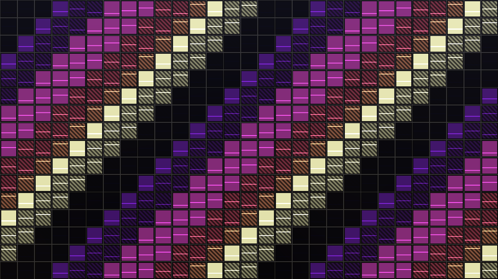
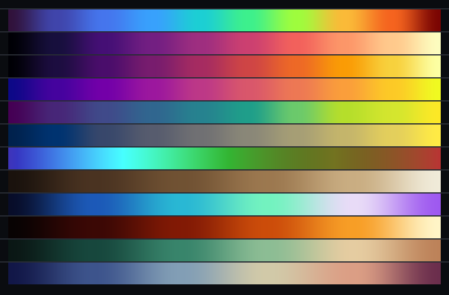

# SUBSTRATA — a WebGL2 atlas of things that remember



A single static page that draws, in seven fragment-shader modes and with an unreasonable number of knobs, the two halves of one argument: **clay keeps impressions and sand does not**, and **a liquid crystal makes the same decision with light instead of sediment**. Rock becomes clay, clay holds a root, sand holds nothing; a cell of rod-shaped molecules imprints a wavefront, and light reads it back.

It runs the claims of the argument as an overlay, so the pictures stay falsifiable: fifteen claims dated 2020–2026, each coloured by domain, filled by how well supported it is, banded by its window of years.



## Running it

There is no build step, no framework, no network. One page, one canvas, plain ES modules:

```sh
cd webgl
python3 -m http.server 8080      # any static server; the shaders are fetched over HTTP
# then open http://localhost:8080/
```

The shaders are fetched as separate files (`js/shaders/*.glsl`), so the page needs an origin — `file://` will not do. Query parameters set the opening state: `?mode=conoscope`, `?preset=Maltese%20cross`, `?seed=7`, `?pane=about`, `?nohud=1`. A share link is the whole configuration, base64url-encoded into the hash.

It needs **WebGL2** with floating-point render targets (`EXT_color_buffer_float` or `EXT_color_buffer_half_float`); without them the memory field and bloom fall back to 8 bits and the page says so in its banner.

## The seven modes

| Mode | Live parameters | What the pixels are | Aux channel |
|---|---|---|---|
| **Substrata** | time constants, sediment, memory | a rolling terrain where traces are stamped into a 2D memory field, then diffused, drifted and left to decay | what the ground still remembers |
| **Director** | cell thickness, twist, tilt, voltage, K11/K22/K33 | liquid-crystal molecules as rods in a real cell, over a field solved along their profiles | how far the director has tilted |
| **Conoscope** | Δn, thickness, NA, aperture, polarisers, slice count | the polarising microscope: every pixel is one ray through a stratified cell, integrated with Jones matrices, at one wavelength band | retardance through the cell |
| **Hologram** | pixel pitch, plate width, carrier, reconstruction | phase recorded by a pixel grid, read back by diffraction: zone plates, off-axis orders, the rainbow on a phone at an angle | phase of the recorded wavefront |
| **Crystal** | species, optic axis, birefringence, pleochroism | a mineral under the march: one polarisation is slowed more than the other, and the difference is the colour | retardance along the chord |
| **Weathering** | hydrolysis, rain, frost, biology, slope, age | rock becoming clay: feldspar to kaolinite as a rate, a rind, a climate | depth of the weathering rind |
| **Causal** | layers, flow, decay, epoch, span | the shape the whole conversation kept rediscovering: dormant substrate → slow mechanism → drastic result, stacked as a field | strength of the field at the top layer |

Every mode is the same program shape (globals + library + optics + marcher + mode fragment), which is why switching costs one program switch and the panel can be built from a registry rather than hand-written.

## What is underneath

Six passes per frame: the substrate memory (decay, diffusion, drift, then stamps), scene A, scene B for split and anaglyph comparison, a bloom chain at half resolution, a composite, and a PNG capture straight out of the drawing buffer.

- **Uniformes are packed.** 264 shader-bound knobs live in 50 `vec4`, 15 `ivec4` and 7 `vec3` bundles, aliased back to real names with `#define` (see `js/uniforms.js`). That is 96 of the 224 uniform vectors WebGL2 guarantees to a fragment shader, so there is room to keep going.
- **The physics is written down, not drawn.** `optics.glsl` holds the Cauchy dispersion, the index ellipsoid, Snell's law for the oblique ray, the coherence envelope, the Jones algebra and the Freedericksz threshold; `lib.glsl` holds the noise, SDFs, rotations, tonemappers and ramps.
- **Retardance is the spine.** A slab retards the wave by δ = 2π·Δn·d/λ, the cell is many slabs, and the analyser turns the accumulated phase into the figure. Set Δn to zero and the crossed polars go black — the diagnostic preset **Blank plate** is exactly this, and every optic on the page is supposed to do nothing.
- **The clock is on the CPU.** Waveform, duty, settle, jitter and the cell's own lag are integrated in `state.js`, then handed to the shaders as `uTime`, `uPulse` and `uLC`.
- **The light is one rig.** Azimuth, elevation, distance, colour, intensity, a second source, a rotatable environment, shadow softness, pulse coupling and jitter, all shared by the five lit modes.

## Driving it

`1`–`7` switch modes · `Space` pauses · `Tab` the panel · `P` presets · `R` randomise · `S` PNG · `L` legend · `H` HUD · `M` evidence overlay · `C` split compare · `G` glyph pass · `Ctrl+K` command palette · `?` help.

Drag the canvas to orbit, shift-drag to pan, wheel to zoom, double-click to reset the camera, click to punch a trace into the ground. The panel has six tabs (Parameters, Presets, Field notes, Shader, Load / save, About): the Parameters tab is generated from the registry, with 287 parameters, filters by subject, groups by theme, and marks each row by disclosure level — level 0 is the surface, level 1 is the workshop, level 2 is the laboratory. Double-clicking a slider returns it to its default.

Twenty-five presets are configurations with an argument attached; each one names the claim it is demonstrating. The **Shader** tab prints the actual fragment shader of the selected mode, line-numbered, because on this page the shader *is* the documentation.

**Honesty flags.** Every parameter that is not a physical quantity carries a mark: `✱` for an artistic multiplier (the page will say when a number is only there to make the picture legible) and `≈` for an approximation (a profile, a slice count, a procedural substitute). The About pane says which parts are exact and which are not.

## The claim overlay

`js/params.js` holds the fifteen claims, each with a domain, a year window and a confidence. The overlay tiles them across the frame; the year band slides as `u_epoch` moves, the fill encodes the confidence (solid measured, hatched plausible, open single-study), and the **Field notes** tab prints each claim with the hinge that makes it interesting. The HUD prints the claim whose window contains the epoch, and the legend names the domain colours.

## Tools

Everything in `tools/` is a checker or a generator, and none of it is needed to run the page:

```sh
node tools/gen-globals.mjs   # params.js → js/shaders/globals.glsl + claims.glsl
node tools/gen-glyphs.mjs    # 3×5 bitmaps → the glyph table the composite pass draws
node tools/validate.mjs      # assembles all 14 programs, parses them, checks the alias table,
                             # the uniform budget, use-before-definition and the ramp mirror
node tools/smoke.mjs         # runs the page in jsdom against a stub GL context: boots it,
                             # switches every mode, opens every pane, applies every preset,
                             # drives the palette, the share link, the JSON round trip and the
                             # keyboard, then renders three seconds of frames
node tools/shots.mjs         # redraws the evidence overlay and the ramps with the shader's own
                             # numbers and writes the two PNGs in ../docs
```

`validate.mjs` and `smoke.mjs` need the dev dependencies in `package.json` (`npm install`); the generators need nothing but Node. `validate.mjs` is deliberately paranoid — it cross-checks the JS ramp stops against the GLSL literals, so the legend cannot silently drift from the shader, and it flags any identifier that looks like a uniform (`uLC` for `u_lc`) but is declared nowhere.

## Honest limits

This sandbox has no GPU and no browser, so **no shader on this page has ever been compiled here**, and the screenshots above are drawn by `tools/shots.mjs` rather than captured. The static checks — a real GLSL parse of all fourteen assembled programs, a use-before-definition scan, the uniform budget, the alias table against `params.js`, and a full jsdom boot — are what standing in for a compiler. If a shader does fail to compile on your machine, the page prints the compiler log with the offending line and the file, which is the fastest way to fix it.

The claims are the claims of the conversation that produced the page: they are labelled with the confidence they were given there, and the weak ones are drawn weak on purpose.

## Files

```
index.html            the page: topbar, canvas, overlays, panel
css/app.css           one stylesheet, three themes (dark, light, neon), no network assets
js/params.js          the registry: 287 parameters, 7 modes, 25 presets, 15 claims, the about text
js/uniforms.js        packing, aliasing and the uniform-vector budget
js/state.js           Config (typed, clamped), randomise, the clock
js/renderer.js        the engine: programs, targets, uniforms, six passes, PNG capture
js/ui.js              the panel, the palette, the presets, the JSON box
js/hud.js             the readouts, the stats, the legend
js/main.js            boot, the render loop, the hooks, every input
js/ramps.js           the colour ramps, shared by the GPU path and the docs
js/shaders/           globals (generated), lib, optics, glyphs (generated), claims (generated),
                      march-sdf, march-height, mode-*, mem-update, mem-stamp, bloom, composite, verts
tools/                generators and checkers, described above
```
